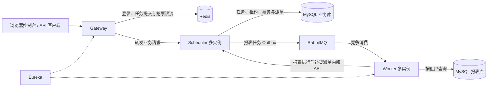

# JobLab · 演唱会票务与周边派单平台

JobLab 是一个基于 Java 的多租户分布式后端，覆盖演唱会抢票、5 分钟锁票、模拟支付和周边补货派单。观众在购票页面下单，运营人员在控制台跟踪补货单和仓库回执。项目也提供即时、延时和 Cron 销售报表调度。

演唱会业务把开售时的库存竞争和付款后的异步派单串在同一条链路上。以东门取货点的限定围巾为例，一笔带周边的付款产生备货需求。取货点缺货时，平台会选择库存充足、能按时到货的仓库，首选仓库拒单后自动改派。支付和仓库回执均为本地演示，履约演示到仓库确认接单为止。

**技术栈**　Java 17、Spring Boot 3.5、Spring Cloud Gateway、Eureka、Spring Security、MySQL、Redis、RabbitMQ、Flyway、Prometheus。

[快速启动](#快速启动) · [演唱会演示](#演唱会演示) · [关键设计](#关键设计) · [API 文档](docs/api.md) · [架构与运维](docs/architecture.md) · [面试讲解](docs/interview.md)

## 系统架构



应用服务独立部署，浏览器控制台随网关打包。报表任务通过 RabbitMQ 触发 Worker 执行，周边补货由 Worker 经内部 API 竞争领取 MySQL 队列中的补货单。Redis 负责入口限流，业务状态和库存以 MySQL 为准。

## 关键设计

| 问题 | 实现 | 代码入口 |
| --- | --- | --- |
| 重复提交与越权访问 | 用 `tenant_id + request_key` 保证租户内幂等，用请求摘要识别同键异参。JWT 关联当前账号与权限版本，任务和报表查询都带租户条件 | [JobService](scheduler-service/src/main/java/io/joblab/scheduler/JobService.java) · [SecurityConfiguration](scheduler-service/src/main/java/io/joblab/scheduler/security/SecurityConfiguration.java) |
| 多个 Scheduler 如何分派任务 | 使用 MySQL `FOR UPDATE SKIP LOCKED` 竞争到期记录。任务状态变更和 Outbox 写入同事务，发布器检查 RabbitMQ Confirm 和不可路由返回，并对失败事件退避重试 | [JobRepository](scheduler-service/src/main/java/io/joblab/scheduler/JobRepository.java) · [OutboxRelay](messaging-core/src/main/java/io/joblab/messaging/OutboxRelay.java) |
| Worker 宕机或迟到回写 | Worker 按投递代次领取任务，获得短期租约和执行令牌。同租户的领取由租户行锁保护，达到配额时任务延后调度。续租与回写都校验令牌和到期时间，租约过期后由调度端恢复 | [JobService](scheduler-service/src/main/java/io/joblab/scheduler/JobService.java) · [JobWorker](worker-service/src/main/java/io/joblab/worker/JobWorker.java) |
| 停机后周期任务怎么恢复 | Cron 表达式和 IANA 时区持久化。规则支持错过后跳过或补跑一次，以及上一轮仍活跃时跳过本轮。触发时刻和规则 ID 组成唯一键 | [ScheduleService](scheduler-service/src/main/java/io/joblab/scheduler/ScheduleService.java) · [Flyway 迁移](scheduler-service/src/main/resources/db/migration/V3__tenant_security_and_schedules.sql) |
| 高峰抢票怎么避免超卖 | 网关用 Redis 限流。MySQL 在同一事务中锁票档、扣减库存并创建 5 分钟锁票，超时释放按订单状态回补 | [TicketService](scheduler-service/src/main/java/io/joblab/scheduler/ticket/TicketService.java) · [TicketExpiration](scheduler-service/src/main/java/io/joblab/scheduler/ticket/TicketExpiration.java) |
| 支付重试或撞上锁票到期怎么办 | 付款和释放先锁同一个票档。付款按数据库时钟校验截止时间，同一事务写入模拟回执和已支付状态，重复请求返回原回执 | [TicketPaymentService](scheduler-service/src/main/java/io/joblab/scheduler/ticket/TicketPaymentService.java) |
| 仓库已接单，但 Worker 宕机怎么办 | 已付款周边按取货点和 SKU 汇总，只对缺口开单。Worker 通过租约竞争领取，接管时用原派单尝试 ID 查询回执，仓库库存扣减与接单回执一起提交 | [ConcertDemandIntake](scheduler-service/src/main/java/io/joblab/scheduler/fulfillment/ConcertDemandIntake.java) · [ConcertFulfillmentService](scheduler-service/src/main/java/io/joblab/scheduler/fulfillment/ConcertFulfillmentService.java) · [ConcertDispatchWorker](worker-service/src/main/java/io/joblab/worker/ConcertDispatchWorker.java) |

一次任务从 `SCHEDULED` 进入 `QUEUED`、`RUNNING`，成功后可下载 CSV。遇到超时或执行失败时，调度端按尝试次数退避。达到上限后，运营可创建关联原任务的重放记录。消息允许重复投递，调度端通过投递代次和租约使结果提交保持幂等。

## 快速启动

准备 Java 17、Maven 和 Docker Compose，在仓库根目录执行以下命令。

```powershell
mvn -B -ntp verify
docker compose up -d --build --scale worker=2 --wait
powershell -NoProfile -ExecutionPolicy Bypass -File .\scripts\verify.ps1
powershell -NoProfile -ExecutionPolicy Bypass -File .\scripts\verify-enterprise.ps1
```

| 本机入口 | 用途 |
| --- | --- |
| `http://127.0.0.1:18080/` | 浏览器控制台与 API 网关 |
| `http://127.0.0.1:18761` | Eureka 实例列表 |
| `http://127.0.0.1:15683` | RabbitMQ 管理台，演示用户 `joblab`，密码 `rabbit_local` |

默认演示租户 `acme` 提供 `admin`、`operator`、`viewer` 和 `buyer` 四种账户，`globex` 提供独立的 `admin`。演示账户密码均为 `JobLab-Demo-2026!`，随 Compose 本地环境初始化。

### 浏览器控制台

打开 `http://127.0.0.1:18080/` 后，使用租户账号登录。控制台提供任务总览、任务筛选及分页、执行详情与 CSV 下载、Cron 规则管理、成员和审计。只读成员可以查看本租户的数据，运营可管理任务和周期规则，管理员还可管理成员与查看审计。

控制台随网关 JAR 一起打包，调用同源 API，无需单独启动前端进程。登录页也提供标记为「演示数据」的工作区，便于在浏览器里查看页面和试用交互。

### 演唱会演示

1. **抢票。** 以 `acme / buyer` 登录，在「演出购票」选择在售场次和票档。抢到后打开「我的票」，查看订单编号和 5 分钟倒计时。要验证超时释放，可让这笔锁票自然过期，再查看余票并重新抢票。
2. **模拟付款。** 在「我的票」点「去结算」，加购「城市回声限定围巾」，选择「东门周边取货点」，再点「确认模拟支付」。核对回执里的门票金额、周边金额和总额。
3. **查看补货派单。** 切换到 `acme / operator`，在「周边派单」打开补货单详情。本地演示初始数据中，滨海前置仓拒单后，星港中转仓接单，两次回执均可查看。

从已有模拟支付数据升级时，保留 MySQL 数据卷即可继续演示。第三阶段会把此前带周边的付款纳入备货扫描。事务边界、状态和验收案例见 [演唱会票务与周边履约](docs/concert-platform.md)。

### 用 PowerShell 提交一份报表

```powershell
$base = 'http://127.0.0.1:18080'
$login = @{
    tenant = 'acme'
    username = 'operator'
    password = 'JobLab-Demo-2026!'
} | ConvertTo-Json -Compress
$token = Invoke-RestMethod -Method Post -Uri "$base/api/auth/token" -ContentType 'application/json' -Body $login
$session = @{ Authorization = "Bearer $($token.accessToken)" }
$headers = $session + @{ 'Idempotency-Key' = [guid]::NewGuid().ToString('N') }
$report = @{
    reportType = 'DAILY_TOTALS'
    fromDate = '2026-01-01'
    toDate = '2026-01-03'
} | ConvertTo-Json -Compress
$job = Invoke-RestMethod -Method Post -Uri "$base/api/jobs" -Headers $headers -ContentType 'application/json' -Body $report
Invoke-RestMethod -Uri "$base/api/jobs/$($job.id)" -Headers $session
```

状态变为 `SUCCEEDED` 后，调用 `GET /api/jobs/{id}/result` 下载 CSV。重新发送同一份请求和幂等键应返回同一个任务 ID。以 `globex` 的令牌查询该任务应得到 `404`。完整权限矩阵和字段见 [API 文档](docs/api.md)。

## 验证与故障演示

- **构建与单元测试。** `mvn verify` 覆盖任务租约、配额退避、Cron 错过策略、CSV 转义以及抢票与锁票校验。
- **真实中间件验证。** 使用 MySQL、Redis 和两个 Scheduler 验证了跨租户访问、令牌撤销、周期触发、并发配额与失败重放。并发验证将租户配额设为 2，两实例同时尝试领取 3 个任务，其中 2 个被领取，另 1 个回到待调度。
- **票务与补货验证。** 8 个请求争抢 2 张票只成功 2 笔。并发重放同一支付请求返回同一回执，过期锁票被拒绝。仓库接单后模拟 Worker 在确认前中断，另一 Worker 复用原回执完成派单，库存只扣一次。
- **Compose 演示。** [verify.ps1](scripts/verify.ps1) 检查提交、RabbitMQ 派发和 CSV 下载。[verify-enterprise.ps1](scripts/verify-enterprise.ps1) 检查角色、租户隔离、令牌撤销和审计。

以下命令用于在本地演示 Worker 宕机接管。

```powershell
$env:REPORT_MIN_RUNTIME_MS = '15000'
docker compose up -d --build --scale worker=2 --wait
powershell -NoProfile -ExecutionPolicy Bypass -File .\scripts\demo-worker-crash.ps1
```

脚本会停止正在执行任务的 Worker，检查执行历史是否先出现 `LEASE_EXPIRED`，再由另一台 Worker 完成同一任务。脚本结束时会尝试启动被停止的容器。清除 `REPORT_MIN_RUNTIME_MS` 并重建 Worker 可恢复默认速度。

## 仓库导航

| 路径 | 内容 |
| --- | --- |
| [gateway-service](gateway-service) · [discovery-service](discovery-service) | 浏览器控制台、API 路由、Redis Lua 限流、Eureka |
| [scheduler-service](scheduler-service) | 权限、周期调度、任务状态、票务结算和补货计划 |
| [worker-service](worker-service) · [messaging-core](messaging-core) | RabbitMQ 消费、报表生成、补货派单、消息协议和 Outbox 发布 |
| [infra](infra) · [scripts](scripts) | MySQL 初始化、Prometheus 告警规则和演示脚本 |
| [docs](docs) | API 契约、架构设计、运维手册和面试追问 |

Compose 默认以单节点中间件运行。可通过 `--scale scheduler=2` 验证调度多实例，通过 `--profile observability` 启用 Prometheus。升级旧版本、密钥配置和生产部署边界见 [架构与运维](docs/architecture.md)。
